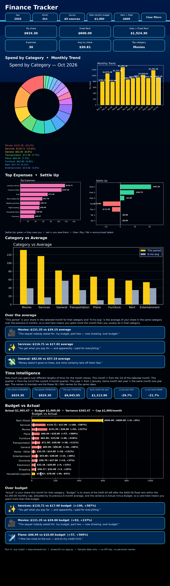

# Finance Tracker — Python dashboard (Streamlit)

A Power BI-style personal finance dashboard built **in Python only**:
one `app.py`, with Streamlit + Plotly + pandas. No separate HTML, CSS,
or JavaScript files — Streamlit renders the page from the Python code.

**The data in this repo is synthetic sample data** (`sample_data.json`,
generated for this portfolio demo). It is not real spending. The private
version loads the author's real Splitwise data from a local `data.json`
that is git-ignored and is not committed here.



*Full dashboard in one long picture, rendered from the sample data in this repo — KPIs, pie, Monthly Trend, Top Expenses, Settle Up, Category vs Average, quotes, Time Intelligence, and Budget vs Actual. Not real spending. No API key or personal names are included in this repo.*

🎬 [Watch the demo video](streamlit-app-2026-10-29-00-24-34.webm) — 29 seconds, scrolling through the deployed dashboard on sample data.

## Resume bullets

Short bullets describing the full build on the author's real data
(1,394 transactions). The demo in this repo runs the same code on
1,108 synthetic expenses.

- Built a Power BI-style Finance Tracker dashboard in Python (Streamlit, Plotly, pandas) on a star-schema model, analysing budget vs. actuals against a $1,000/month cap, spending trends, and variances across 28 categories with DAX-style time-intelligence measures.
- Automated data preparation from the Splitwise API and personal expenses, deduplicating payments and Splitwise-paid amounts for repeatable monthly budget and variance analysis across 1,394 transactions.

## Run it

```bash
pip install -r requirements.txt
streamlit run app.py
```

Then open the local URL Streamlit prints (usually http://localhost:8501).

## What it does

- **Slicers** (a strip at the top of the dashboard, in the main page —
  no sidebar): Year, then Month, then Source
  (All / Splitwise / Personal (PDF)), plus Total / Rent budget inputs,
  then the visuals right below in the same page.
- **Interactive, cross-filtering charts** — click a pie slice, a month
  bar, a category bar, a top expense, a Settle Up bar, or a Budget bar
  to filter every other visual, the numbers, and the slicers to that
  choice. Click the same item again, or Clear filters, to clear it.
- **Spend by Category** — pie with a pie-only colour palette, my share only.
- **Monthly Trend** — my share per month, last 12 months ending at the
  selected month. All bars are one yellow; the selected month has a white
  outline. Earliest / Prev / Next / Present-month buttons, with the
  12-month window shown under the chart. Clear filters resets
  Year/Month/Source to the latest month.
- **Top Expenses, Settle Up, Category vs Average** — cross-filtered by the
  category / person filters. Settle Up is a diverging bar visual
  (green = they owe you, red = you owe them), anonymised Owe/Pay/Pal labels.
- **Time Intelligence** — MTD, QTD, YTD, same month prior year, YoY % and
  MoM %, labelled with their DAX equivalents (TOTALMTD, TOTALQTD,
  TOTALYTD, SAMEPERIODLASTYEAR). Equivalent DAX formulas are in
  `data-model.md`.
- **Budget vs Actual** — $1,000/month total, $600 fixed Rent (a separate
  fixed cost outside Splitwise), the remaining $400 allocated across other
  categories in proportion to their prior 6-month average. Horizontal
  rows, Rent first, then biggest over-budget first, each row showing
  Actual / Budget and variance $ and %.
- **🌊 Background** — navy-blue to black, like ocean meeting sky: deep
  navy at the top fading to black, with a glowing horizon line. Set in
  Python (`.streamlit/config.toml` theme + a gradient in `app.py`).
- **💬 Fun emojis + quotes** — wherever a category is over its 6-month
  average, or over budget, the dashboard shows an emoji and a quote for
  that category (e.g. 🍕 for Dining out, 🛒 for Groceries). They appear
  only in those over-average / over-budget places, not everywhere.

## Data model — star-schema-inspired

See `data-model.md`: Fact_Expenses (one row per expense, my share =
`owed_share`), Dim_Date, Dim_Category (28 categories in the sample data),
Dim_Group, Dim_Person (anonymised), Dim_Currency (USD only in chart
totals). Payments / settlements are excluded so money moving between
people is not double-counted as spending.

## Honest tech note

This is not Power BI, DAX, Power Query, or Excel. The analysis — budget
vs actuals, spending trends, variances across 28 categories — is the same
analysis those bullets describe, and the time-intelligence measures use
the same logic as the DAX functions named in the UI, implemented in
Python/pandas. The automated monthly refresh in the private build is a
Python script + scheduled job fetching the Splitwise API, which requires
a Pro subscription to register an app and a stored API key.

## Use it with your own Splitwise data (locally only)

```bash
export SPLITWISE_API_KEY="your-key"   # never commit this
python3 scripts/fetch_splitwise.py    # writes data.json (git-ignored)
streamlit run app.py                  # data.json takes priority over sample data
```

## Files

- `app.py` — the whole dashboard, Python only.
- `sample_data.json` — synthetic sample data.
- `requirements.txt` — streamlit, plotly, pandas.
- `.streamlit/config.toml` — dark navy/black theme.
- `scripts/fetch_splitwise.py` — local-only Splitwise fetch (env key).
- `data-model.md` — star schema + DAX-equivalent measures.
